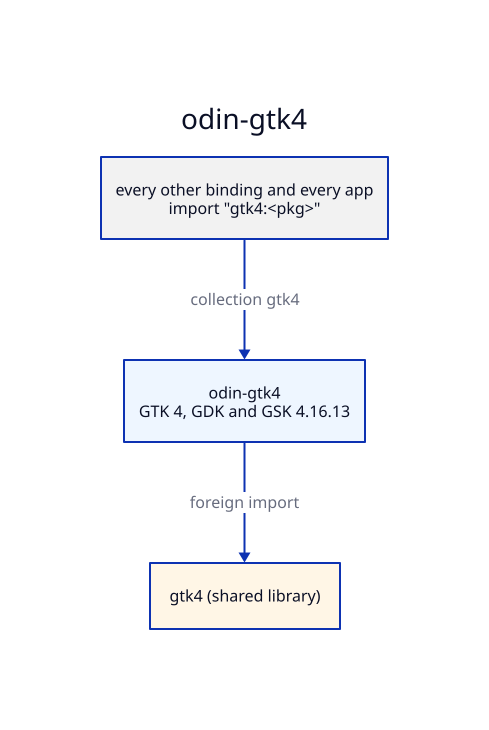

# Architecture: odin-gtk4

## Generation

`make generate` runs runic over each package's `rune.yml`. The headers are /usr/lib/amber-gtk4/include/gtk-4.0 (amber-gtk4-dev).
The output is committed, so consumers need neither runic nor the headers to build.

## Patches

Where runic gets a signature wrong, the fix is made by hand, listed in
[PATCHED.md](PATCHED.md), and pinned in `<pkg>/patched.odin` by a typed variable. A
regeneration that drops a patch then fails to compile.

## Collections

The collection `gtk4` points at this repo's root. Packages import their siblings and the
bindings below them through collections, never by relative path: `gdkx` imports `gtk4:gtk4` for
GDK's types and odin-x11's `x11:xlib` for Xlib's. `scripts/generate.sh` links `/usr/include/X11`
alone into `build/x11/`, so runic reads Xlib without the rest of the system headers.

